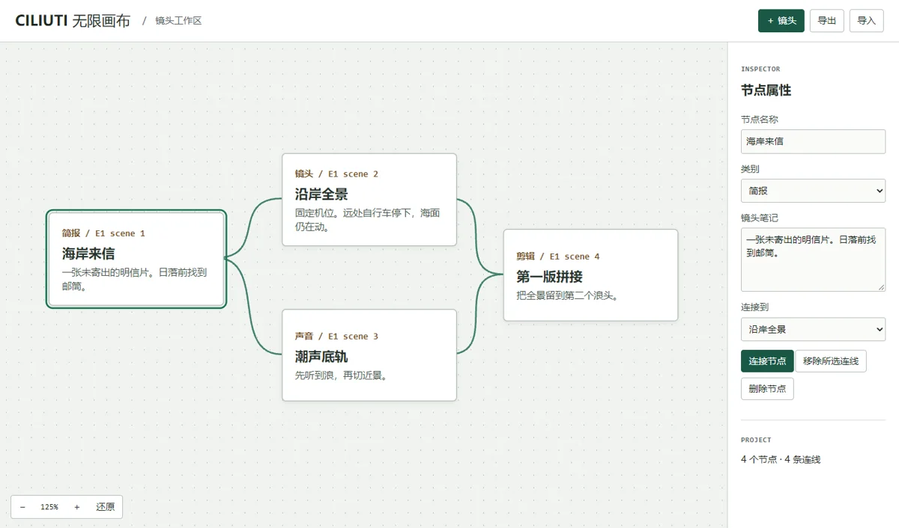
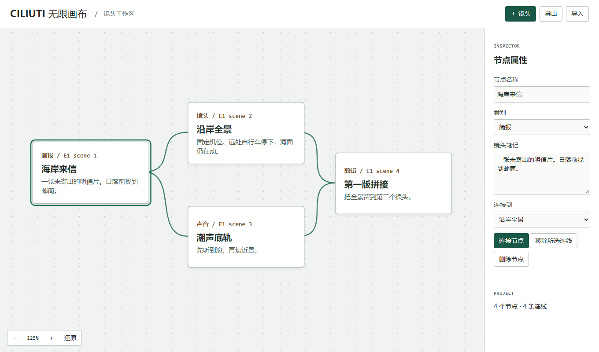
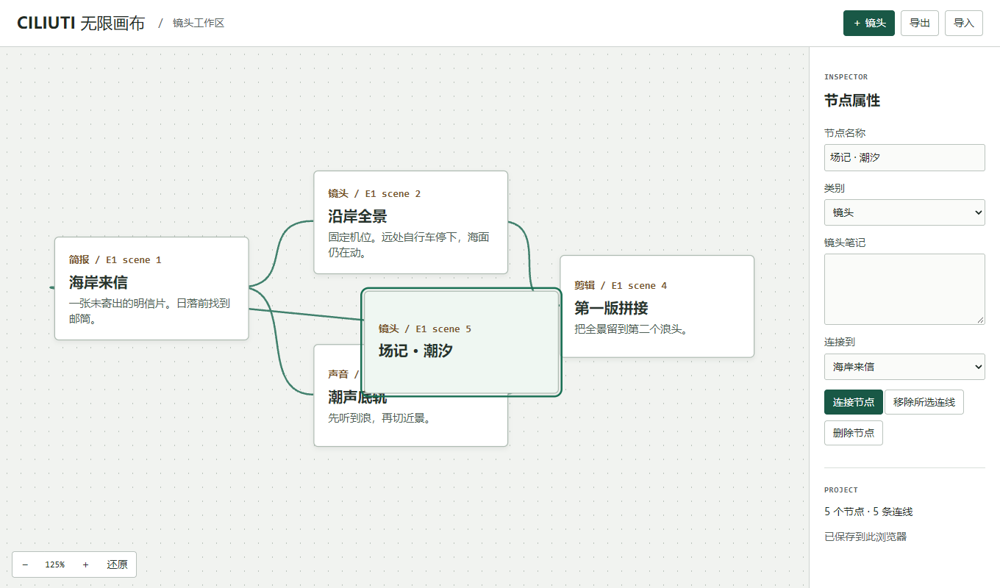

# CILIUTI 无限画布社区版

围绕同一镜头组织简报、声音和剪辑，在一张可平移缩放的画布上编辑节点、保存关系，再把项目带到另一台设备。

## 实际界面巡览



上图由两张本次实际运行画面的截屏轮换组成，不是连续操作录像。

| 画布概览 | 编辑后重新导入的镜头 |
| --- | --- |
|  |  |

## 可以做什么

- 新增一个镜头并编辑场记
- 选择目标节点，建立或移除连线
- 导出可读的 JSON，重新导入并还原节点位置

## 本地运行

```sh
python -m http.server 8000 --bind 127.0.0.1
```

在浏览器打开 `http://127.0.0.1:8000/`。只监听本机；不执行部署。

## 实测与范围

新增、改名、连线、导出 JSON 字节、文件输入回读及刷新后恢复均通过。

本次新增的是独立浏览器编辑器；staging 中保留了桌面工程实际采用的 Apache-2.0 站位核心和上游署名。未发布基于 Elastic-2.0 的桌面主程序、模型连接、OpenCut 时间线或渲染器。

[手机宽度实机截屏（390 px）](showcase/03-mobile.png) · [授权范围](LICENSE) · [来源与署名](NOTICE.md)
